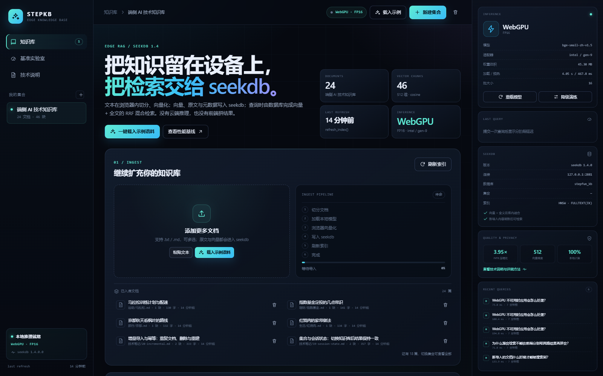
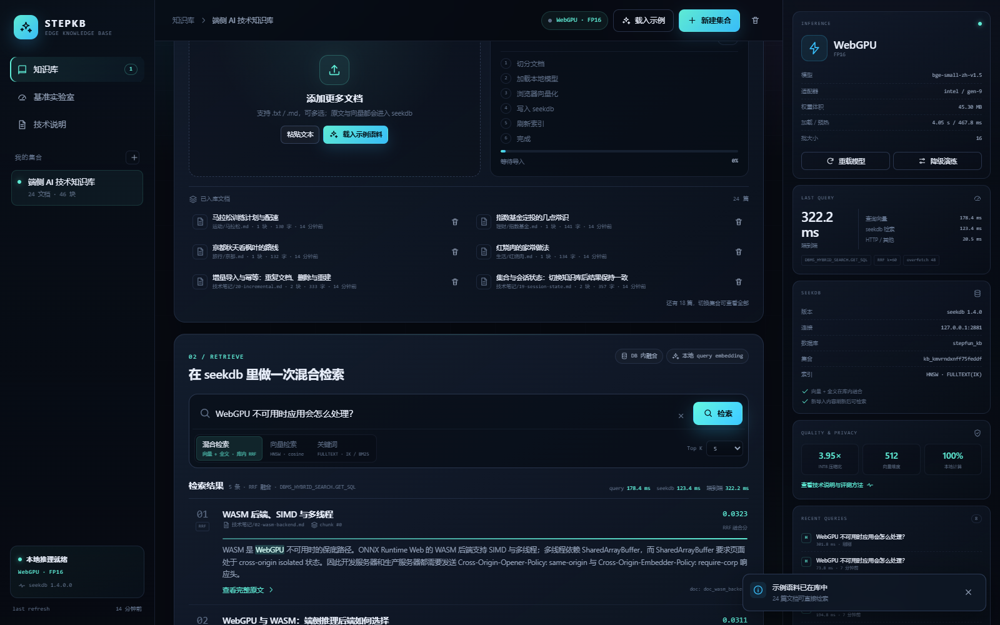
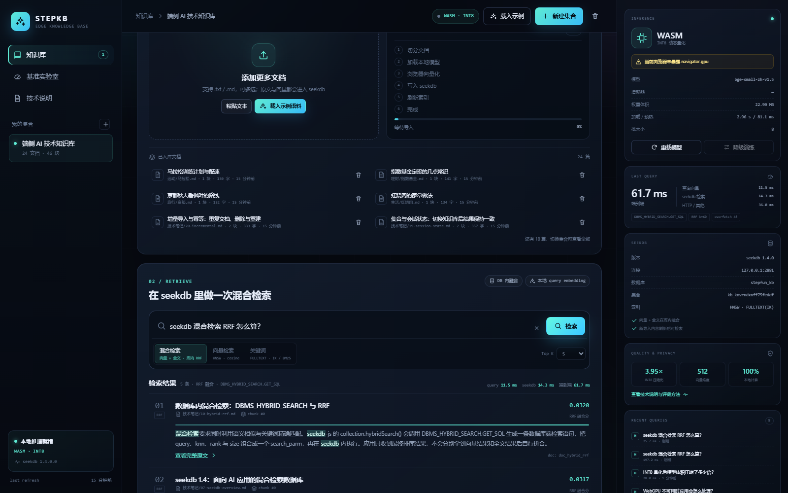
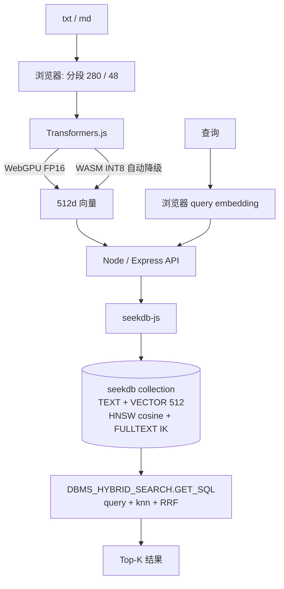

# STEPKB · 端侧 AI 知识库

> 文本在浏览器里切分、向量化；向量、原文与元数据写入 **seekdb**；查询时由 **seekdb 在数据库内**完成向量 + 全文的 RRF 混合检索。没有云端推理，也没有前端拼结果。

- 分支：`2026-competition-ecosystem`
- 模型：`Xenova/bge-small-zh-v1.5`，revision `75c43b0`，512 维，MIT
- 推理：Transformers.js 3.7.6 + ONNX Runtime Web；WebGPU/FP16 优先，失败自动降级到 WASM/INT8
- 检索：seekdb 1.4.0 + `DBMS_HYBRID_SEARCH.GET_SQL`，HNSW(cosine) + FULLTEXT(IK) + RRF



## 30 秒启动

前置：Node.js ≥ 20.19、Docker Desktop、支持 WebGPU 的 Edge/Chrome（不支持也能跑 WASM）。

```bash
docker compose up -d      # seekdb 1.4.0，127.0.0.1:2881
npm install
npm run setup             # 按固定 revision 下载 ONNX / tokenizer 到 public/models
npm run dev               # Vite :5173 + API :8787
```

打开 <http://127.0.0.1:5173>，点击「载入示例语料」，再输入问题检索。首次加载模型需要读取 22.9 MB（INT8）或 45.3 MB（FP16）本地权重；之后会复用浏览器缓存。

生产模式：

```bash
npm run build
npm start                 # 默认 http://127.0.0.1:8787，静态资源 + API 同端口
```

## 它做了什么

### 1. 浏览器本地向量化

- 文件拖入后按约 280 字切块、48 字重叠；块 ID 由 `docId` + 块序号组成。
- `@huggingface/transformers` 的 `feature-extraction` pipeline 在本地执行，`allowRemoteModels=false`，只读取同源 `/models`。
- 启动时检测 `navigator.gpu`、`requestAdapter()` 与 `shader-f16`；WebGPU 成功则使用 `fp16`，否则自动使用 WASM `q8`，界面展示当前后端、精度、适配器与降级原因。
- 查询侧加 BGE 中文检索指令前缀，与文档侧使用同一模型、同一精度口径。

### 2. seekdb 持久化与数据库内混合检索

每个知识库对应一个 collection，schema 同时声明：

```ts
new Schema({
  fulltextIndex: new FulltextIndexConfig("ik", { ik_mode: "smart" }),
  vectorIndex: new VectorIndexConfig({
    hnsw: { dimension: 512, distance: "cosine" },
    embeddingFunction: null,
  }),
});
```

搜索调用 `collection.hybridSearch()`，由 seekdb 执行 `DBMS_HYBRID_SEARCH.GET_SQL`：

```ts
await collection.hybridSearch({
  query: { whereDocument: { $contains: sanitizedQuery } },
  knn: { queryEmbeddings: [queryVector] },
  rank: { rrf: { rankWindowSize: 60, rankConstant: 60 } },
  nResults: 48,              // 先多取候选
  include: ["documents", "metadatas"],
});
```

结果在数据库内按 `Σ 1/(60 + rank)` 融合；服务端只按 docId 收起同一文档的多个块，**顺序仍以数据库返回的 RRF 排名为准**，不会分别请求向量和全文再由客户端拼合。关键词模式同样走 `DBMS_HYBRID_SEARCH`（只保留 `query` 子句），向量模式走 HNSW `collection.query()`。

写入完成后调用 `collection.refresh_index()`（底层 `CALL dbms_index_manager.refresh()`），新块随后可被检索；导入流程把「切块 → 向量化 → 写入 → 刷新」的每个阶段与耗时展示在界面上。

### 3. 增量与会话

- 文档内容 SHA-256 生成稳定 docId；重复导入先按 docId 删除旧块，再写入新块，避免重复结果。
- `kb_registry` / `kb_docs` / `search_logs` 保存集合、文档与检索审计；当前 kbId 写入 `localStorage`，刷新后恢复。
- 新增文档不需要重建 collection；整批导入只刷新一次索引。

## 性能与质量（本机实测）

环境：Windows 11、Edge 156（Chromium 156）、**Intel UHD Graphics 630（Gen9）**、seekdb `5.7.25-OceanBase seekdb-v1.4.0.0`、Node 24。语料 24 篇 / 46 块 / 24 条标注查询；查询重复 3 轮取中位数，冷加载取 3 个新上下文中位数。

| 配置 | 冷加载 | 预热 | 向量化/块 | 查询向量 | seekdb | 端到端 | Recall@5 | nDCG@5 |
|---|---:|---:|---:|---:|---:|---:|---:|---:|
| FP32 / WASM · b8 | 5.71 s | 71 ms | 60.0 ms | 12.4 ms | 9.1 ms | 36.4 ms | 97.9% | 92.4% |
| INT8 / WASM · b8 | 3.18 s | 78 ms | 42.8 ms | 9.2 ms | 9.6 ms | 32.9 ms | 93.8% | 91.1% |
| INT8 / WASM · b1 | 5.39 s | 79 ms | 36.1 ms | 8.6 ms | 9.3 ms | 33.4 ms | 93.8% | 90.6% |
| FP16 / WebGPU · b16 | 4.75 s | 471 ms | 50.2 ms | 24.4 ms | 10.6 ms | 52.6 ms | 97.9% | 92.4% |
| FP16 / WebGPU · b1 | 4.25 s | 478 ms | 52.0 ms | 23.5 ms | 10.1 ms | 51.1 ms | 97.9% | 92.4% |

模型文件：

| 精度 | 文件 | 大小 | 压缩比 |
|---|---|---:|---:|
| FP32 | `onnx/model.onnx` | 94,851,877 B（90.46 MiB） | 1.00× |
| FP16 | `onnx/model_fp16.onnx` | 47,497,427 B（45.30 MiB） | 2.00× |
| INT8 | `onnx/model_quantized.onnx` | 24,010,842 B（22.90 MiB） | **3.95×** |

**诚实结论**：这台集成显卡上，FP16/WebGPU 的查询向量比 INT8/WASM 慢约 2.6 倍，文档向量化也略慢；小模型 + 弱 GPU 并不天然适合 WebGPU。应用仍按需求把 WebGPU 作为优先路径，并保留自动降级与「降级演练」按钮；如果目标是低延迟交互，WASM/INT8 更合适。独立显卡或更大模型上 WebGPU 的批处理优势更明显。

INT8 相对 FP32：Recall@5 -4.2 pp、nDCG@5 -1.2 pp、Top-5 文档重合 94.2%；FP16 在 24 条查询上与 FP32 指标持平。质量优先时使用 FP16，带宽/兼容优先时使用 INT8。Windows 主机冷加载存在 3–30 s 的文件缓存与杀软抖动，表格取三次中位数，完整原始样本在 `benchmarks/results/`。



无 WebGPU 时自动降级为 WASM/INT8，并在 Inspector 中展示降级原因：



## 复现实验

```bash
npm run verify            # 健康检查 + 写入 + hybrid/vector/keyword 三种检索
npm run bench             # Playwright 驱动 Edge，跑 5 组配置，写 public/benchmarks/summary.json
npm run bench:summary     # 打印 Markdown 表格
```

`npm run bench` 依赖：

- 已启动的 API 与 Vite（`npm run dev`）；
- 本机 Edge，默认路径 `C:\Program Files (x86)\Microsoft\Edge\Application\msedge.exe`，可用 `EDGE_PATH` 覆盖；
- 可用 `BENCH_API` / `BENCH_WEB` 改地址；`BENCH_HEADLESS=0` 可看有头运行。

每次运行会创建临时知识库，结束后删除；原始逐查询结果写入 `benchmarks/results/bench-<timestamp>.json`，汇总写入 `public/benchmarks/summary.json`。

## 架构



## 项目结构

```text
stepfun/
├─ src/                     React UI + 浏览器 embedder / 切块 / 评测页
│  ├─ lib/embedder.ts       WebGPU → WASM 自动降级、批量向量化
│  ├─ lib/chunk.ts          段落优先切块、SHA-256 文档 ID
│  ├─ components/           导入、检索、Inspector、Bench、技术说明
│  └─ api.ts                /api 客户端
├─ server/                  Express + seekdb-js
│  ├─ db.ts                 bootstrap、kb_registry / kb_docs / search_logs
│  ├─ kb.ts                 collection、混合检索、刷新、日志
│  └─ index.ts              REST API、静态服务、安全响应头
├─ scripts/
│  ├─ fetch-models.mjs      固定 revision 下载 + 大小校验 + manifest
│  ├─ bench.mts             Playwright 性能/质量基准
│  ├─ verify.mjs            端到端冒烟检查
│  └─ summarize-bench.mts   打印基准表
├─ public/
│  ├─ demo-corpus.json      24 篇示例语料 + 24 条标注查询
│  ├─ models/manifest.json  模型文件清单（权重本身 gitignore）
│  ├─ benchmarks/           基准汇总
│  └─ technical-note.md     一页技术说明（UI 内渲染）
├─ docs/technical-note.md   技术说明源文件
├─ docker-compose.yml       seekdb 1.4.0，数据卷持久化
└─ .env.example
```

## API

| 方法 | 路径 | 说明 |
|---|---|---|
| GET | `/api/health` | seekdb 版本、模型清单、集合数 |
| GET | `/api/kbs` | 知识库列表（含文档/块计数） |
| POST | `/api/kbs` | 新建知识库与 collection |
| GET | `/api/kbs/:id` | 知识库详情、文档、最近检索 |
| DELETE | `/api/kbs/:id` | 删除 collection、登记与日志 |
| POST | `/api/kbs/:id/chunks` | 写入一篇文档的块（文本 + 向量 + 元数据） |
| DELETE | `/api/kbs/:id/docs/:docId` | 删除文档及其块 |
| POST | `/api/kbs/:id/refresh` | `refresh_index()` |
| POST | `/api/kbs/:id/search` | hybrid / vector / keyword |
| GET | `/api/kbs/:id/logs` | 最近检索日志 |

## 配置

复制 `.env.example` 为 `.env`：

```ini
PORT=8787
SEEKDB_HOST=127.0.0.1
SEEKDB_PORT=2881
SEEKDB_USER=root
SEEKDB_PASSWORD=
SEEKDB_DATABASE=stepfun_kb
```

Vite 的 `/api` 代理会读取同一个 `PORT`。如果本机 2881 或 8787 已被占用，改这两个端口即可。

### 模型下载

`npm run setup` 从 Hugging Face 固定 revision 下载 9 个文件，并校验字节数后写 `public/models/manifest.json`。模型权重不进 git；离线演示可在有网机器执行一次 setup，把 `public/models/` 整个目录带过去。若网络需要代理，可先设置系统代理，并确认 Node 的 `fetch` 能访问 `huggingface.co`。

### seekdb 镜像

`docker-compose.yml` 固定 `oceanbase/seekdb:1.4.0-100000172026082615`。如果本地/镜像仓库没有该 tag，可先拉取 `oceanbase/seekdb:latest`，确认版本为 `5.7.25-OceanBase seekdb-v1.4.0.0` 后重打 tag；应用只依赖 1.4 的向量、FULLTEXT 与 `DBMS_HYBRID_SEARCH` 接口。

## 限制

- 24 篇 / 46 块是桌面小规模评测，不代表百万级向量下的 HNSW 调参结论。
- 质量只覆盖混合检索，未加入 reranker、长文档或跨语言评测。
- 单机单浏览器数据；WebGPU 驱动与集显功耗策略会造成查询延迟波动。
- INT8 有可测量的召回损失；对质量敏感的场景应选择 FP16/FP32。

## 许可与致谢

- 代码：本仓库竞赛分支。
- 模型：[BAAI/bge-small-zh-v1.5](https://huggingface.co/BAAI/bge-small-zh-v1.5)（MIT），ONNX 转换来自 [Xenova/bge-small-zh-v1.5](https://huggingface.co/Xenova/bge-small-zh-v1.5)。
- 数据库：[OceanBase seekdb](https://github.com/oceanbase/seekdb)。
- 推理运行时：[Transformers.js](https://github.com/huggingface/transformers.js) / ONNX Runtime Web。
